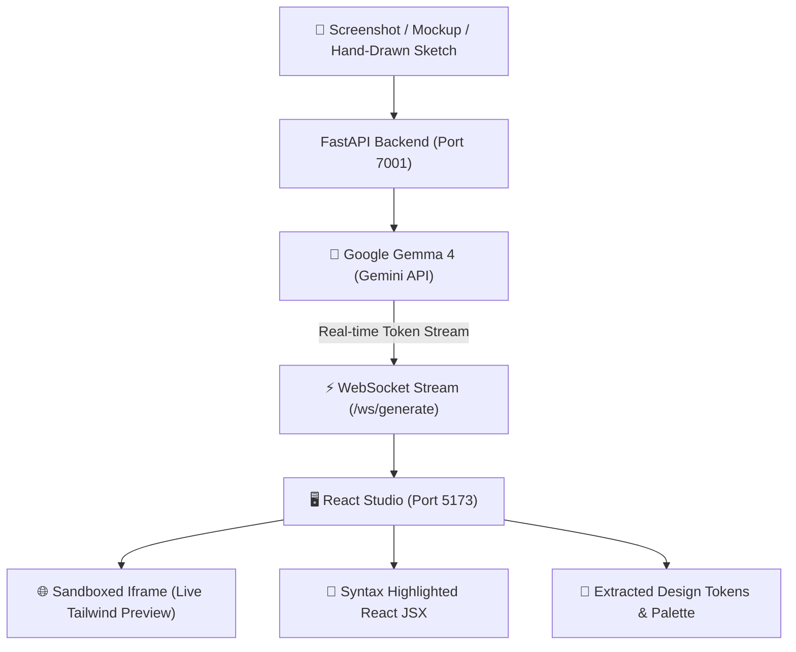

# ⚡ SnapToStack
> **Snap a mockup. Ship the full stack.**

[](https://opensource.org/licenses/MIT)
[-blue)](https://ai.google.dev/gemma)
[](https://agentskills.io)
[](https://events.mlh.io/events/15429-hacktoberfest-hack-day-gwalior-x-itm-university)

**SnapToStack** is an open-source visual-to-code compiler that transforms UI mockups, Figma screenshots, and hand-drawn whiteboard wireframes into clean, production-ready React + Tailwind CSS components in seconds. 

Built for **Hacktoberfest Hack Day Gwalior x ITM University (MLH)**, powered by Google DeepMind's open-weights **Gemma 4** multimodal model and packaged as a compliant **Agent Skill**.

---

## 🏆 Hackathon Tracks Entered

### 1. 💎 Best Use of Gemma 4 (Google DeepMind)
* Uses Google DeepMind's lightweight, open-weight **Gemma 4** (`gemma-4` multimodal) accessed through the Gemini API.
* Implements deep multimodal vision understanding: decomposes component hierarchy, extracts color palettes, calculates responsive layout grids, and synthesizes interactive JSX code with zero hallucinated CSS.

### 2. 🏆 Best Open-Source AI Project (DigitalOcean)
* **100% Open Source:** Licensed under the permissive MIT license on a public GitHub repository.
* **Agent Skill Open Standard Compliance:** Includes a standardized `.agents/skills/snap-to-stack/SKILL.md` specification allowing any AI coding agent (Cursor, Claude Code, Copilot, Antigravity) to invoke SnapToStack natively.
* **Dual Execution Harness:** Can be run as a fullstack web studio (React + FastAPI) or via a standalone developer CLI (`python -m backend.main --image mockup.png`).

---

## 🏗️ Architecture & Workflow



---

## ✨ Features

- **⚡ Real-Time Streaming:** Code tokens stream live over WebSockets so you can watch your components write themselves.
- **🛡️ Live Sandboxed Preview:** Instant interactive browser sandbox with Tailwind CSS CDN loaded on the fly.
- **📱 Responsive Viewport Switcher:** Test your generated UI across Desktop, Tablet, and Mobile frames with 1-click.
- **🎨 Design Token Extraction:** Automatically identifies and visualizes hex color swatches and component hierarchy.
- **📋 Clipboard Integration:** Hit `Ctrl+V` anywhere in the app to instantly compile screenshots from your clipboard.
- **🎯 1-Click Export:** Download a ready-to-run `.tsx` component or copy code to clipboard.
- **🔌 Agent Skill Support:** Drop `.agents/skills/snap-to-stack/` into your agent workspace to enable visual component synthesis directly in your terminal.

---

## 🛠️ Tech Stack

* **Frontend:** React 18, Vite, TypeScript, Tailwind CSS, Lucide Icons
* **Backend:** Python 3.10+, FastAPI, Uvicorn, WebSockets
* **AI Model:** Google DeepMind Gemma 4 (`gemma-4` multimodal via `google-genai` SDK)
* **Protocol:** WebSockets for live token streaming + REST API for Agent Skills

---

## 🚀 Quickstart Guide

### Option A: Running with Docker (Fastest)

```bash
git clone https://github.com/amanmaurya92/SnapToStack.git
cd SnapToStack
docker-compose up -d --build
```
Open **`http://localhost:5173`** in your browser!

---

### Option B: Running Locally

#### 1. Backend Setup
```bash
cd backend
pip install -r requirements.txt

# (Optional) Set your Gemini API key in .env or via Settings UI in the app
echo "GEMINI_API_KEY=your_key_here" > .env

python main.py
```
*Backend runs on `http://localhost:7001` (WebSocket: `ws://localhost:7001/ws/generate`)*

#### 2. Frontend Setup
```bash
cd ../frontend
npm install
npm run dev
```
*Frontend runs on `http://localhost:5173`*

---

### Option C: CLI Mode (Agent Skill)

You can run SnapToStack directly from your terminal to compile any image into a component:

```bash
python -m backend.main --image assets/dashboard_sketch.png --output App.tsx
```

---

## 📜 Agent Skill Open Standard

SnapToStack is built from day one to be consumed by autonomous coding agents. See [`.agents/skills/snap-to-stack/SKILL.md`](.agents/skills/snap-to-stack/SKILL.md) for complete schema and integration guides.

---

## 📄 License

Distributed under the **MIT License**. See [`LICENSE`](LICENSE) for more information.

---

*Created with ❤️ for Hacktoberfest 2026 at ITM University Gwalior.*
